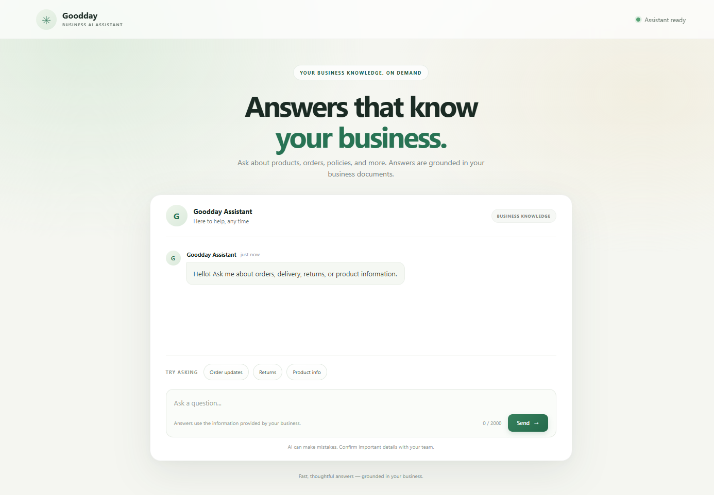

# Business AI Assistant

A Flask chatbot that retrieves relevant passages from local Markdown and text
files, then uses Anthropic Claude to answer from that business information.
This is retrieval-augmented generation, not model fine-tuning.

## Run locally (Windows PowerShell)

```powershell
py -3 -m venv .venv
.\.venv\Scripts\Activate.ps1
python -m pip install -r requirements.txt
Copy-Item .env.example .env
```

Set `ANTHROPIC_API_KEY` in `.env`, add approved `.md` or `.txt` business
documents beside `app.py`, then start the server:

```powershell
python app.py
```

Open http://127.0.0.1:5000. Check `http://127.0.0.1:5000/health` for service
status. Never commit `.env`, real API keys, or private customer information.

## Response speed and availability

The app uses Claude Haiku, limits retrieved context and output size, and bounds
the provider request with a 2.5-second timeout and no retries. A timeout returns
an error rather than a late answer. End-to-end responses under three seconds and
24/7 availability cannot be guaranteed by application code alone; they also
depend on provider/network latency, document size, Render cold starts, and the
service plan.

## API

`POST /api/chat` accepts JSON such as:

```json
{"question":"How can I get an order update?"}
```

Questions must be non-empty and no longer than 2,000 characters. Answers
include source filenames when available. If no relevant document is found, the
assistant returns a fallback without calling the model.

Run tests with:

```powershell
python -m pytest -q
```

## Portfolio entry

## Goodday Business AI Assistant

[](https://goodday-business-ai-assistant.onrender.com)

**Live demo:** [goodday-business-ai-assistant.onrender.com](https://goodday-business-ai-assistant.onrender.com)  
**Repository:** [github.com/anindozedeck/BUSINESS-AI-ASSISTANT](https://github.com/anindozedeck/BUSINESS-AI-ASSISTANT)

**What it does:** Answers customer questions using relevant passages from a
business's FAQs, product information, and policies.
**Who it helps:** Kenyan small businesses, especially online retailers and
service providers handling frequent customer enquiries.
**Problem it solves:** Reduces the time staff spend searching documents and
writing repetitive answers about orders, delivery, returns, and products.
**Stack:** Python, Flask, Anthropic Claude Haiku API, Markdown/text retrieval,
pytest.
